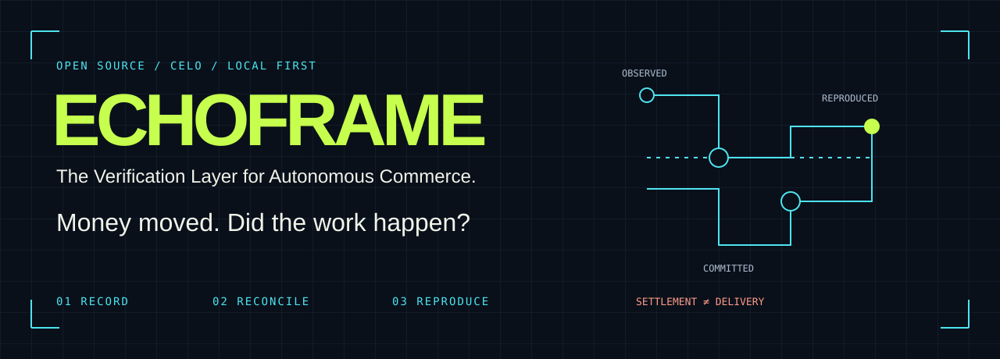
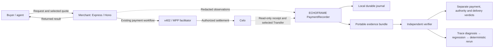
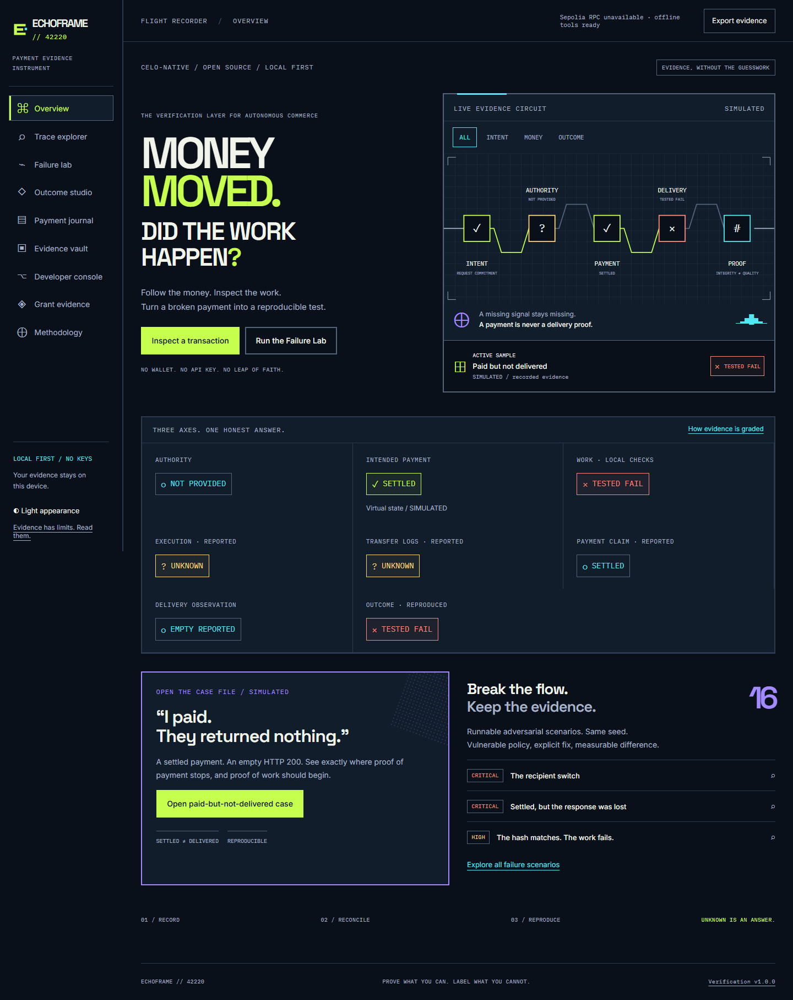

<p align="center"></p>

[](https://github.com/eshaanvgupta/echoframe/actions/workflows/ci.yml) [](LICENSE) [](.node-version)

**[Open the application](https://eshaanvgupta.github.io/echoframe/) · [Release & package downloads](https://github.com/eshaanvgupta/echoframe/releases/tag/v1.1.1) · [Integration guide](docs/integration.md) · [Technical evidence](docs/technical-evidence.md) · [Grant dossier](docs/prezenti-grant-dossier.md)**

A payment receipt answers one question: did a payment event occur? It does not tell a buyer whether the merchant returned the promised result, whether the result passed its declared checks, or whether a timed-out request is safe to repeat.

ECHOFRAME records these boundaries and makes them reproducible. It is an implemented, local-first verification and payment reliability layer for Celo commerce: **nine reusable packages**, Express/Hono instrumentation, independent outcome checks, durable journals, a read-only CLI/MCP interface, a static web application and **16 deterministic failure scenarios**. It has no mandatory AI model, hosted database, paid API or wallet connection. Optional live payment examples require separate, explicit authorization.

## Five-minute quickstart

Use **Node 24 LTS** and **pnpm 10.34.9**. Windows PowerShell users can use `corepack.cmd` if script policy blocks the command shim.

```sh
git clone https://github.com/eshaanvgupta/echoframe.git
cd echoframe
corepack enable
corepack pnpm install --frozen-lockfile
corepack pnpm dev
```

Open **http://127.0.0.1:5173**. Choose **Open paid-but-not-delivered case**, inspect the separate payment and work verdicts, open a diagnostic finding, then run **Fix & Re-run** in Failure Lab. The case is explicitly **SIMULATED**. Nothing signs or spends funds. [Reproduce the full demonstration](docs/demo.md).

For an independent CLI demonstration:

```sh
corepack pnpm build:packages
corepack pnpm cli init local-evidence/demo
corepack pnpm cli verify local-evidence/demo/sample.echoframe.json --json
corepack pnpm cli replay response-lost --seed 42220
corepack pnpm cli replay response-lost --safe --seed 42220
corepack pnpm cli integration-test --json
```

## Follow the evidence



The recorder observes the developer's payment stack. It never signs, broadcasts, refunds or retries a payment. The optional MetaMask example delegates the one approved testnet settlement to the official merchant/facilitator SDK workflow.



| Surface | Implemented behavior | Boundary |
| --- | --- | --- |
| Trace Explorer | Bounded imports, event provenance, read-only Celo inspection, selected log and trace diagnostics | Imported payment claims cannot promote themselves into trusted settlement |
| Failure Lab | 16 seeded cases, explicit vulnerable/safe policies, timeline, fix/rerun and runnable exports | Simulations do not demonstrate a production vulnerability |
| Outcome Studio | Visual bounded DSL, content/schema/status/bounds checks, independent proof reproduction | Subjective quality and unverifiable source claims remain unresolved |
| Payment Journal | Durable SQLite/IndexedDB attempt identity, conservative recovery and settlement uniqueness | Local files are plaintext; deletion removes local retry protection |
| Evidence Vault | Local persistence, intentional complete/public exports, encrypted files and contained HTML | No cloud synchronization or automatic backup |
| Developer Console | Executable integrations, official challenge codecs, six read-only MCP tools | No wallet keys; unsupported protocol profiles fail closed |
| Methodology & grant evidence | Proof semantics, factual ledger, genuine Sepolia evidence and reproduction instructions | No external audit, independent adoption or mainnet-use claim |

## Install the SDKs

Registry publication is separate. The GitHub release supplies all nine versioned tarballs, checksums and static assets. Install the tarballs together so local package dependencies resolve without an npm namespace:

```sh
node scripts/install-release.mjs ../echoframe-consumer
```

This downloads all nine public release tarballs, checks their SHA-256 values and installs them together into a new project. It refuses an existing directory. [Manual distribution instructions](docs/distribution.md) explain the checksums and npm publication boundary. `corepack pnpm test:consumer` independently packs and tests the checkout outside the monorepo.

| Package | Responsibility |
| --- | --- |
| `@echoframe/core` | Canonicalization, evidence roots, verification, policies, diagnosis and replay |
| `@echoframe/celo` | Read-only chain, receipt/block and exact ERC-20 attribution |
| `@echoframe/x402` | Strict v2 exact EIP-3009 observation profile |
| `@echoframe/mpp` | Official MPP `evm` one-shot `charge` observation profile |
| `@echoframe/erc8183` | Pinned draft reference ABI, strict events and job reads |
| `@echoframe/node` | Express/Hono PaymentRecorder, SQLite journals and intentional exports |
| `@echoframe/cli` | Independent verify, inspect, diagnose, replay and integration self-test |
| `@echoframe/mcp` | Six non-signing tools via the official MCP SDK |
| `@echoframe/react` | Reusable, accessible evidence verdict components |

Minimal instrumentation, before the developer's existing payment middleware:

```ts
import { PaymentRecorder, SqliteAttemptJournal } from '@echoframe/node';

const recorder = new PaymentRecorder({
  protocol: 'x402', chainId: 11142220, environment: 'TESTNET',
  payment: { token, recipient, sender, amount: '10000' },
  journal: new SqliteAttemptJournal('./attempts.sqlite'),
  storagePath: './recordings.sqlite',
});
app.use(recorder.express()); // Use recorder.hono() with a Hono app.
// Mount your existing supported payment workflow next.
```

`token`, `recipient` and `sender` are the application's explicit expected addresses. The default records metadata and commitments. [The complete guide](docs/integration.md) includes runnable Express/Hono apps, opaque request IDs, optional outcome policies, restart recovery, exports, independent verification and unsupported cases.

## Genuine Celo Sepolia evidence

One owner-approved **0.01 test-USDC** purchase used MetaMask, official x402 SDK 2.31.0 and the hosted Celo Sepolia facilitator. No synthetic settlement response was used. This is a **self-operated testnet integration**, separate from independent ecosystem adoption.

- Transaction: [`0x2054f2592088b6aca722c555e0472267eab9b3a24091a743ff38c6b711930d32`](https://celo-sepolia.blockscout.com/tx/0x2054f2592088b6aca722c555e0472267eab9b3a24091a743ff38c6b711930d32).
- Exact chain/token/buyer/seller/atomic expectations matched **Transfer log 1** using read-only RPC; execution succeeded.
- The HTTP 200 retained result passed independently reproduced presence, schema and exact-value checks.
- The original protocol response header was rejected. Its failure remains in the bundle; a separately persisted genuine facilitator SDK reference enabled read-only recovery. No second payment occurred.
- No authority signature is retained. Imported payment observations remain untrusted until independently re-fetched; deterministic outcome checks reproduce offline.

[Complete redacted bundle](docs/evidence/celo-sepolia-2026-11-19/complete-redacted.echoframe.json) · [Matched expectations/log](docs/evidence/celo-sepolia-2026-11-19/payment-match.json) · [Outcome proof](docs/evidence/celo-sepolia-2026-11-19/outcome-proof.json) · [Verification report](docs/evidence/celo-sepolia-2026-11-19/verification-report.json) · [Runnable regression](docs/evidence/celo-sepolia-2026-11-19/purchase.regression.test.ts)

Publication of these five redacted files was explicitly authorized by their owner. [Run your own opt-in Sepolia integration](examples/celo-x402-live/README.md). Starting the example never initiates a purchase; review, signature and submission are separate actions.

## Verification, support and contribution

```sh
corepack pnpm release:check
node scripts/report.mjs
corepack pnpm --filter @echoframe/web build:pages
corepack pnpm test:pages
corepack pnpm audit:secrets
```

[GitHub Actions](https://github.com/eshaanvgupta/echoframe/actions/workflows/ci.yml) independently runs the complete suite on clean Linux checkouts, external packed-package installation, generated regressions, four responsive widths, offline recovery, automated accessibility, performance and dependency/license audits. Exact counts, environment and limits are recorded in [release verification](docs/release-verification.json), [technical evidence](docs/technical-evidence.md) and the versioned evidence archive. Browser emulation does not establish physical-device compatibility.

Hash consistency is not authenticity. RPC observations are not light-client consensus proofs. Settlement does not prove delivery. Source authenticity, mandate authority and subjective quality remain separate. See [proof semantics](docs/proof-semantics.md), [protocol matrix](docs/protocol-matrix.md), [threat model](docs/threat-model.md) and [security policy](SECURITY.md). Report suspected vulnerabilities privately; never attach credentials or payment signatures to public issues.

[Contribute a reproducible case](CONTRIBUTING.md) · [Changelog](CHANGELOG.md) · [MIT license](LICENSE) · [Third-party notices](THIRD_PARTY_NOTICES.txt) · [Free static deployment](docs/deployment.md)
