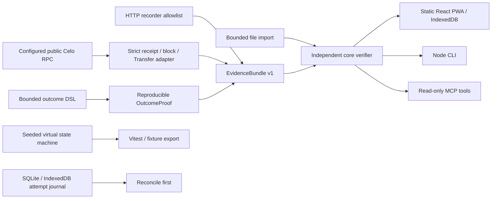

# Architecture and data model

`packages/core/src/types.ts` is the exact runtime Zod schema and TypeScript model. Bundles are strict version 1.0.0 documents with separate environment, protocol, actors, claims, offers, event chain, transaction references, RPC observations, artifacts, outcomes, redaction profile, mandate, recovery state, policy and algorithm version. Unknown fields and schema versions fail closed.

Every event has a stable ID, sequence index, ISO time, timestamp provenance, prior-event hash and domain-separated content hash. All event commitments, manifest bytes and outcomes feed the bundle root. Bundle signatures are external to the root. Artifact bytes are inline base64, at most 2MB each, and checked against Web Crypto SHA-256, exact size and manifest ID. Complete imports are capped at 8MB, 5000 events, depth 48, 100 artifacts and bounded headers. No decompression is accepted.

`OutcomeProof` embeds the exact policy and input, event ID, chain, content SHA-256, manifest keccak256, input commitment, per-check results and proof commitment. Verification reruns the policy and checks the trace event's selected content commitment. A source signature checks the declared signer over raw SHA-256 bytes using personal-sign. Optional proof/bundle signatures use the documented EIP-712 commitment envelope. These are distinct statements.

Attempt identity is `{chainId,protocol,requestId,payer,payee,token,amount,quoteHash}` with lowercased addresses before hashing. SQLite uses `BEGIN IMMEDIATE`, primary keys, immutable identity and append-only triggers. A partial unique settlement evidence index prevents reusing one settlement attribution on multiple attempts. Browser IndexedDB uses read/write transactions and checks uniqueness inside the same transaction. User-controlled deletion explicitly removes that local protection.

Node SQLite is synchronous inside atomic transactions and requires Node >=24. It is a local process store, not a multi-host database. Browser modules contain no Node driver. Packages have explicit ESM exports and declaration files; a clean temporary consumer installs packed tarballs and imports every package.

The app serves static HTML, CSS, JavaScript, licensed local fonts and SVG. Its service worker caches only build-listed same-origin assets and the app shell. It never caches RPC requests or imported evidence. There is no server, paid backend, analytics endpoint, external font request or AI dependency.

## Durable instrumentation and diagnosis (1.1)

`PaymentRecorder` wraps actual Express response write/end/finish/close and actual Hono Request/Response dispatch. A bounded observer hashes application response bytes; no response chunks survive unless explicit JSON projection capture is configured. Official codecs inspect credentials transiently. Stored context hashes bind method, route commitment, protocol, chain and opaque correlation ID. Original quote commitments and safe authorization fingerprints persist in a private local SQLite recorder store. The separate append-only attempt journal maintains financial recovery identity; each uses its own local transaction. A crash between them is conservatively recoverable, not a claim of atomic multi-database capture.

Finalization is serialized per context so concurrent outcomes cannot reuse an event binding. Policy proofs commit the retained projection and a separate observation commits the original response digest; their relationship is recorder-reported. Stable settlement attribution commits chain/transaction/log independent of provider annotations. Read-only reconciliation is explicit and requires complete trusted expectations and chosen log for a positive intended-payment observation.

`diagnoseBundle` verifies before classifying supported event conditions. Findings retain supporting event IDs/hashes, missing evidence, observed-condition severity, safe action, reproducibility and related simulation. The CLI, MCP and frontend share this pure diagnosis engine. Generated trace tests use JSON literals and fixed assertions; imported code is never executed. Evidence/proof schema 1.0.0 remains compatible; report/diagnosis 1.1.0 explicitly separates reported, observed and independently reproduced axes.
